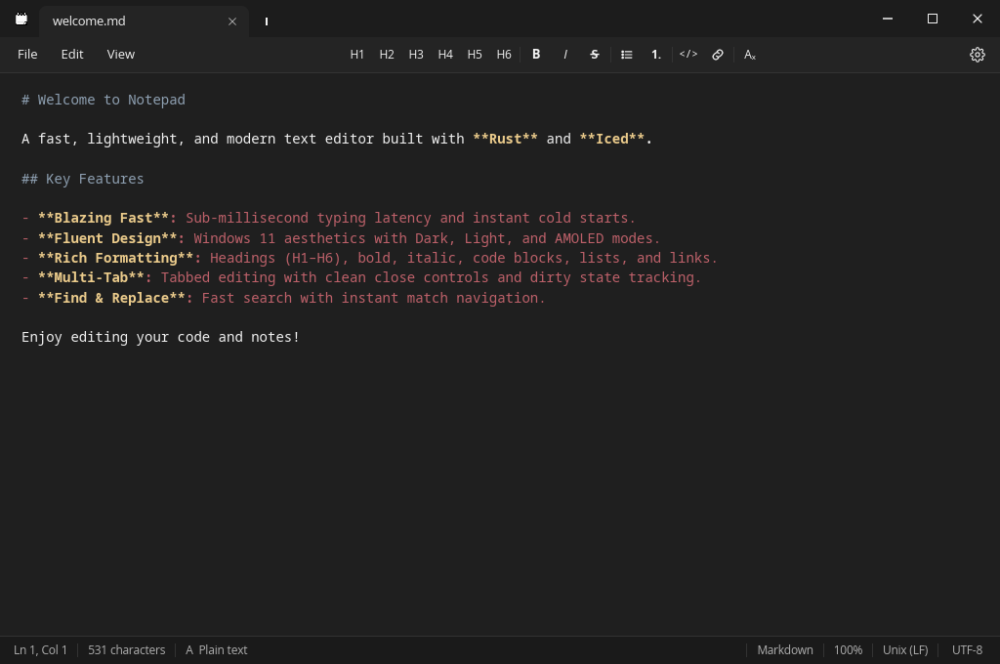
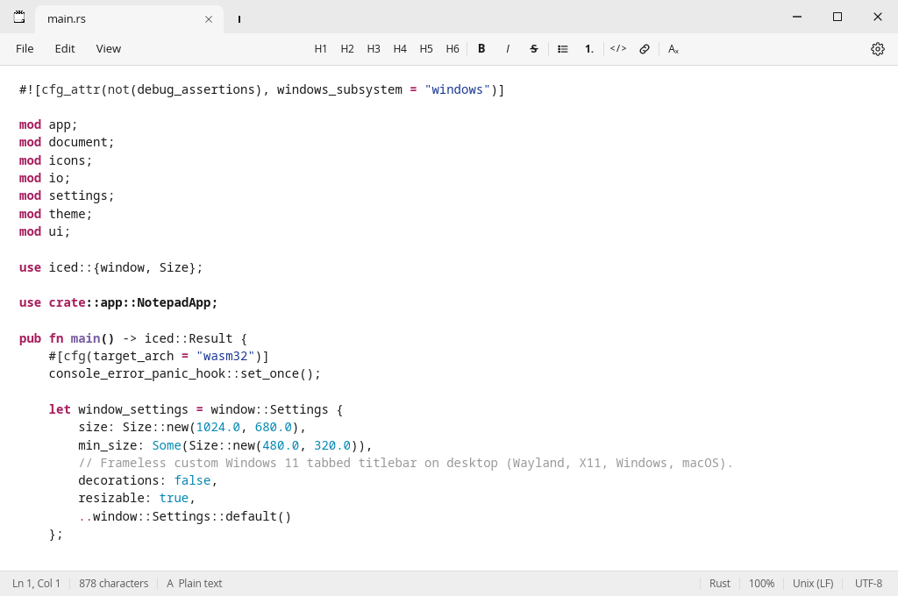
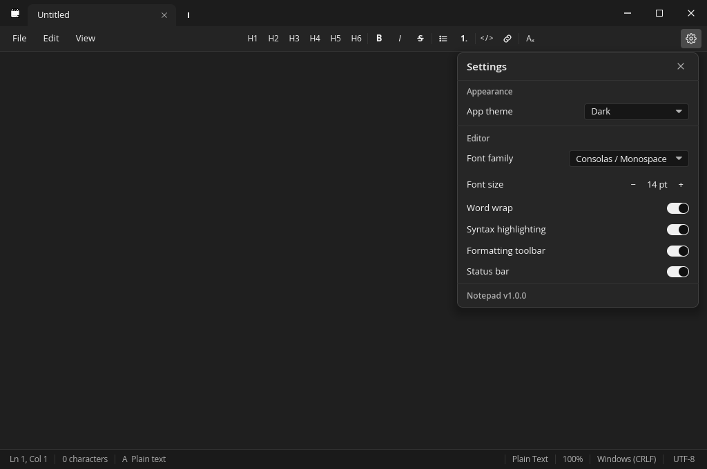

# Notepad

<div align="center">

[](https://github.com/deactivated0/Notepad/actions/workflows/ci.yml)
[](https://github.com/deactivated0/Notepad/actions/workflows/release.yml)
[](LICENSE)
[](https://www.rust-lang.org)

**A high-performance, lightweight, and modern text editor built with Rust and Iced.**  
Features native Windows 11 Fluent aesthetics, sub-millisecond typing latency, multi-tab editing, rich formatting, and pure monochrome themes (Light, Dark, and AMOLED).

[Installation](#installation) • [Releases](#releases) • [Features](#features) • [Screenshots](#screenshots) • [Keyboard Shortcuts](#keyboard-shortcuts) • [NixOS Flake](#nixos-flake)

</div>

---

## Screenshots

<div align="center">

### Dark Mode


<br/>

### Light Mode


<br/>

### Settings Flyout


</div>

---

## Features

- **Blazing Performance**: Sub-millisecond $O(1)$ typing metrics, coalesced undo snapshots, zero-copy line indexing, and 0% idle CPU/GPU consumption.
- **Fluent Windows 11 Aesthetics**: Frameless tabbed titlebar, custom caption controls, smooth rounded tabs with dirty state indicators, and floating overlay cards.
- **Pure Monochrome Themes**: High-contrast, distraction-free Light, Dark, and true black AMOLED modes (zero distracting colors or blue accents).
- **Rich Formatting Toolbar**: Quick insertion and toggling of Markdown Headings (`H1`–`H6`), Bold (`B`), Italic (`I`), Strikethrough (`S`), Lists, Code Spans, and Links.
- **Formatted Preview Mode**: One-click toggle between raw text and formatted live preview.
- **Find & Replace**: Non-blocking floating search bar with match counter, instant navigation, match case, and batch replacement.
- **Comprehensive Status Bar**: Real-time line/column positions, character counts, document type indicator, zoom percentage, line ending mode (`CRLF`/`LF`), and encoding.
- **Multi-Platform**: Native support for Linux (Wayland & X11), macOS (Metal), Windows (DirectX 12/Vulkan), and FreeBSD.

---

## Releases

Pre-compiled production binaries for all major operating systems and architectures are available on the [**GitHub Releases Page**](https://github.com/deactivated0/Notepad/releases).

| Platform | Target Architecture | Package |
| :--- | :--- | :--- |
| **Linux** | `x86_64-unknown-linux-gnu` | `.tar.gz`, `.deb`, standalone binary |
| **Linux (ARM64)** | `aarch64-unknown-linux-gnu` | `.tar.gz`, standalone binary |
| **macOS (Apple Silicon)** | `aarch64-apple-darwin` | `.tar.gz`, `.dmg` |
| **macOS (Intel)** | `x86_64-apple-darwin` | `.tar.gz`, `.dmg` |
| **Windows** | `x86_64-pc-windows-msvc` | `.zip`, `.msi`, `.exe` |

SHA256 checksums are provided with each release asset for cryptographic verification.

---

## Installation

### Linux

#### Universal Linux (Pre-built Binary)
Download the latest pre-compiled archive from [Releases](https://github.com/deactivated0/Notepad/releases):
```bash
# Download and extract the latest release
curl -sSL https://github.com/deactivated0/Notepad/releases/latest/download/notepad-v1.0.0-x86_64-unknown-linux-gnu.tar.gz | tar -xz

# Install to system path
sudo install -m 755 notepad /usr/local/bin/notepad
```

#### Arch Linux / Manjaro
From the AUR (Arch User Repository):
```bash
# Using yay
yay -S notepad-iced-bin

# Or using paru
paru -S notepad-iced-bin
```

#### Ubuntu / Debian / Linux Mint / Pop!_OS
Download and install the official `.deb` package:
```bash
# Download .deb from releases
curl -sSLO https://github.com/deactivated0/Notepad/releases/latest/download/notepad_1.0.0_amd64.deb

# Install package
sudo apt install ./notepad_1.0.0_amd64.deb
```
*Or build from source with required libraries:*
```bash
sudo apt update && sudo apt install -y pkg-config libxkbcommon-dev libwayland-dev libgl1-mesa-dev libx11-dev
cargo install --git https://github.com/deactivated0/Notepad
```

#### Fedora / RHEL / CentOS Stream
```bash
# Install dependencies and build via Cargo
sudo dnf install -y gcc pkgconf-pkg-config libxkbcommon-devel wayland-devel mesa-libGL-devel libX11-devel libXcursor-devel libXi-devel libXrandr-devel
cargo install --git https://github.com/deactivated0/Notepad
```

#### openSUSE (Tumbleweed & Leap)
```bash
sudo zypper install -y pkg-config libxkbcommon-devel wayland-devel Mesa-libGL-devel libX11-devel
cargo install --git https://github.com/deactivated0/Notepad
```

#### Alpine Linux
```bash
sudo apk add cargo pkgconf libxkbcommon-dev wayland-dev mesa-dev libx11-dev
cargo install --git https://github.com/deactivated0/Notepad
```

#### Void Linux
```bash
sudo xbps-install -S cargo pkg-config libxkbcommon-devel wayland-devel MesaLib-devel libX11-devel
cargo install --git https://github.com/deactivated0/Notepad
```

#### Gentoo
```bash
emerge --ask x11-libs/libxkbcommon dev-libs/wayland media-libs/mesa x11-libs/libX11
cargo install --git https://github.com/deactivated0/Notepad
```

---

### macOS

#### Homebrew
```bash
brew tap deactivated0/tap
brew install notepad
```

#### Direct Download
1. Download `notepad-v1.0.0-aarch64-apple-darwin.tar.gz` (Apple Silicon M1/M2/M3/M4) or `notepad-v1.0.0-x86_64-apple-darwin.tar.gz` (Intel) from [Releases](https://github.com/deactivated0/Notepad/releases).
2. Extract and move `Notepad.app` to `/Applications`.

#### Cargo
```bash
cargo install --git https://github.com/deactivated0/Notepad
```

---

### Windows

#### WinGet
```powershell
winget install deactivated0.Notepad
```

#### Scoop
```powershell
scoop bucket add extras
scoop install notepad-iced
```

#### Direct Download
1. Download `notepad-v1.0.0-x86_64-pc-windows-msvc.zip` from [Releases](https://github.com/deactivated0/Notepad/releases).
2. Extract anywhere and launch `notepad.exe`.

#### Cargo
```powershell
cargo install --git https://github.com/deactivated0/Notepad
```

---

### FreeBSD

Notepad compiles natively on FreeBSD using the standard ports/pkg toolchain:

```sh
# 1. Install required build dependencies and graphics libraries
sudo pkg install rust pkgconf libxkbcommon wayland mesa-libs libX11 libXcursor libXi libXrandr

# 2. Build and install via Cargo
cargo install --git https://github.com/deactivated0/Notepad
```

---

### NixOS (Flake)

Notepad provides a first-class `flake.nix` in the repository.

#### Quick Run (Without Installing)
Run Notepad directly via `nix`:
```bash
nix run github:deactivated0/Notepad
```

#### In System Flake Configuration
Add Notepad to your `flake.nix` inputs:
```nix
{
  inputs = {
    nixpkgs.url = "github:NixOS/nixpkgs/nixos-unstable";
    notepad = {
      url = "github:deactivated0/Notepad";
      inputs.nixpkgs.follows = "nixpkgs";
    };
  };

  outputs = { self, nixpkgs, notepad, ... }: {
    nixosConfigurations.yourhostname = nixpkgs.lib.nixosSystem {
      system = "x86_64-linux";
      modules = [
        {
          environment.systemPackages = [
            notepad.packages.x86_64-linux.default
          ];
        }
      ];
    };
  };
}
```

#### User Profile Install
```bash
nix profile install github:deactivated0/Notepad
```

#### Development Shell
```bash
nix develop github:deactivated0/Notepad
```

---

## Keyboard Shortcuts

| Shortcut | Action |
| :--- | :--- |
| `Ctrl + T` / `Cmd + T` | New Tab |
| `Ctrl + W` / `Cmd + W` | Close Active Tab |
| `Ctrl + O` / `Cmd + O` | Open File |
| `Ctrl + S` / `Cmd + S` | Save File |
| `Ctrl + Shift + S` / `Cmd + Shift + S` | Save As |
| `Ctrl + F` / `Cmd + F` | Find |
| `Ctrl + H` / `Cmd + H` | Find & Replace |
| `Ctrl + Z` / `Cmd + Z` | Undo |
| `Ctrl + Y` / `Cmd + Y` | Redo |
| `F5` | Insert Current Date and Time |
| `Ctrl + +` / `Ctrl + =` | Zoom In |
| `Ctrl + -` | Zoom Out |
| `Ctrl + 0` | Reset Zoom to 100% |
| `Ctrl + ,` | Toggle Settings Flyout |
| `Esc` | Dismiss Overlays / Menus |

---

## AI Maintainer Guidelines

For automated agents and contributors maintaining this repository, please consult [**SKILL.md**](SKILL.md) for architectural invariants, latency requirements, Resvg geometry rules, and testing workflows.

---

## License

This project is licensed under the [MIT License](LICENSE).
